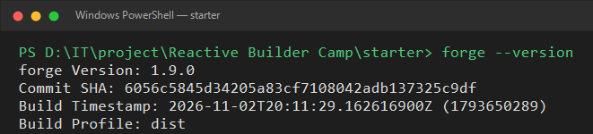
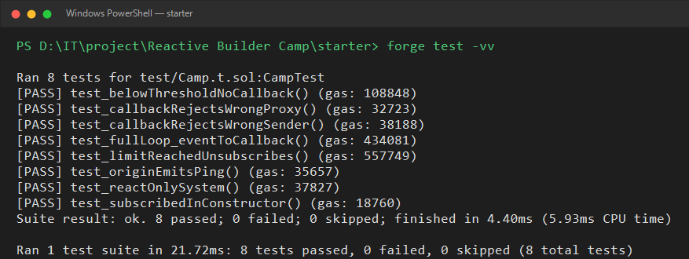

# 第 0 周准备清单 · 提交材料

> 2026-11-17 生成。所有链上数据都是 `cast` 直查的，链接可直接点开核对。

## 1. 测试钱包地址

```
0xAFDF23f148BFaA585418F02d1DD120Fd81211C7f
```

- 类型：MetaMask 独立账户（`reactive Camp`），只用于本期，不存任何资产
- Sepolia：**0.4775 ETH**（pk910 PoW faucet 挖取）
- Base Sepolia：0（待桥）
- Lasna：0 lREACT（待领）

## 2. lREACT 持有证明（Lasna）

浏览器链接：

<https://lasna.reactscan.net/address/0xAFDF23f148BFaA585418F02d1DD120Fd81211C7f>

> 状态：**⏳ 待领取**。官方文档给的 Ethereum Sepolia faucet 地址 `0x9b9BB25f…f434` 经 4 个 RPC 交叉验证是空账户（0 字节代码、nonce 0），发进去会丢币；可用的 faucet 在 Base Sepolia（`0x2afa…5967`，1534 字节代码、余额 8.2 ETH），所以要先桥一点 ETH 过去。
> 详见 [notes/faucet-lreact.md](notes/faucet-lreact.md)。

## 3. GitHub 学习仓库

<https://github.com/jianzhenyuan8-collab/reactive-camp-notes>

公开仓库，含 `README.md`、`notes/`（每日打卡）、`AI-CONTEXT.md`（给 AI 的上下文）、`scripts/`（领币脚本）。

## 4. forge --version



附加：starter 模板本地测试 **8/8 通过**（不需要测试币，链下全链路）：



## 附：环境清单

| 工具 | 版本 | 位置 |
|---|---|---|
| forge / cast / anvil | 1.9.0 | `%USERPROFILE%\.foundry\bin`（已进 PATH） |
| gh CLI | 2.104.0 | `%LOCALAPPDATA%\gh`（已进 PATH） |
| Solc | 0.8.29 | Foundry 自动管理 |

环境搭建踩的坑（TLS、子模块、执行策略、faucet 风控）记录在 [notes/D01-2026-11-17.md](notes/D01-2026-11-17.md)。
