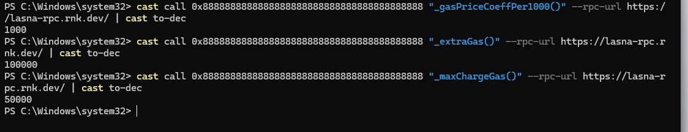

# D1 · Reactive 费用、余额与欠费机制

> 2026-11-18 实测。目标：读取 Lasna 系统合约的费用参数，并理解一次 `react()` 怎样收费、合约的钱放在哪里，以及执行失败为什么仍然收费。

## 实测环境

| 项目 | 值 |
|---|---|
| 网络 | Reactive Lasna |
| RPC | `https://lasna-rpc.rnk.dev/` |
| 系统合约 | `0x8888888888888888888888888888888888888888` |

## 三条 cast 命令和输出

### 1. Gas 价格系数

```powershell
cast call 0x8888888888888888888888888888888888888888 "_gasPriceCoeffPer1000()" --rpc-url https://lasna-rpc.rnk.dev/ | cast to-dec
```

输出：

```text
1000
```

### 2. 固定附加 Gas

```powershell
cast call 0x8888888888888888888888888888888888888888 "_extraGas()" --rpc-url https://lasna-rpc.rnk.dev/ | cast to-dec
```

输出：

```text
100000
```

### 3. 收费过程的 Gas 上限

```powershell
cast call 0x8888888888888888888888888888888888888888 "_maxChargeGas()" --rpc-url https://lasna-rpc.rnk.dev/ | cast to-dec
```

输出：

```text
50000
```

## 实测截图



## 1. 一次 react() 的费用怎么算？

先区分两个概念：

- **Gas：** 执行代码用了多少计算工作量，不是钱；
- **Gas Price：** 每一单位 Gas 要付多少钱。

就像“用电量 × 每度电价格 = 电费”。Reactive 的公式是：

```text
费用 = 基础 Gas 价格 × 系数 ×（react() 实际消耗 Gas + 固定附加 Gas）
```

各变量的意思：

- `tx.gasprice`：这笔 Reactive 交易实际采用的 Gas 单价；
- `block.basefee`：当前区块规定的最低 Gas 单价；
- 基础 Gas 价格：上面两个数中较大的一个；
- 系数：`_gasPriceCoeffPer1000 ÷ 1000`；
- 固定附加 Gas：`_extraGas`，用于覆盖事件处理、记账和收费等系统工作。

本次实测系数为：

```text
1000 ÷ 1000 = 1
```

所以当前公式可以简化为：

```text
费用 = 基础 Gas 价格 ×（react() 实际消耗 Gas + 100000）
```

例如基础 Gas 价格是 `1 gwei`，`react()` 实际用了 `80000 gas`：

```text
计费 Gas = 80000 + 100000
         = 180000 gas

费用 = 1 gwei × 1 × 180000
     = 180000 gwei
     = 0.00018 lREACT
```

`_maxChargeGas = 50000` 不放进上面的乘法公式。它不是钱，也不是 `react()` 的 Gas 上限，而是系统调用合约的 `pay()` 收取费用时，允许这段“收钱代码”最多使用的 Gas。`pay()` 写得太复杂、超过这个预算，就可能付款失败并留下 debt。

## 2. balance、reserves、debt 分别是什么？

| 名称 | 大白话 | 存放位置 |
|---|---|---|
| `balance` | 合约自己口袋里的 lREACT | Reactive 合约地址 |
| `reserves` | 提前充给系统的专用话费 | 系统合约的内部账本 |
| `debt` | 已经产生但没有付清的欠费 | 系统合约的内部账本 |

收费顺序可以理解为：

```text
产生执行费用
      ↓
先扣 reserves
      ↓ 不够
系统调用 pay()，尝试从 balance 收钱
      ↓ 仍然付不起
记录为 debt，并暂停服务
```

系统规定只要 `debt > 0` 就不再投递新的 `react()`。这像手机欠费停机：如果欠费后还能继续使用，欠款只会越来越多。必须先把 debt 清零，合约才能恢复执行。

### 钱怎样充进去？

推荐通过系统合约的 `depositTo()` 充值：

```powershell
cast send 0x8888888888888888888888888888888888888888 "depositTo(address)" $REACTIVE_CONTRACT_ADDR --value 1ether --rpc-url https://lasna-rpc.rnk.dev/ --private-key $REACTIVE_PRIVATE_KEY
```

在 Lasna 上，命令中的 `1ether` 表示 `1 lREACT`。`depositTo()` 会先清偿 debt，剩余金额再进入 reserves。

也可以直接向 Reactive 合约地址转 lREACT，使它增加 balance。但直接转账不会立刻增加 reserves，也不会自动清除已经存在的 debt；如果不确定，优先使用 `depositTo()`。

> 上面的充值命令只是模板，需要替换成自己的合约地址并在本机安全设置私钥。私钥不能写进笔记、提交到 GitHub 或出现在截图中。

## 3. react() 执行回滚了，还收费吗？

**收费。**

回滚的意思是：代码执行途中遇到 `require` 失败、`revert`、错误解码或除以零等问题，本次执行造成的状态修改会被撤销。例如计数器临时从 5 改成 6，后面发生错误，最终会恢复成 5。

但是系统已经匹配事件、创建交易并运行了一部分代码，计算资源已经消耗，所以费用不会退回。回滚会被记录为 `ReactiveContractReverted`，并照常收费。

这对合约设计的启示：

- 不要用 `require` 或 `revert` 过滤普通的不匹配事件；
- 不匹配时用 `if (...) return;` 正常结束；
- 解码前先确认 topic 和数据格式；
- 订阅条件尽量准确，减少无关事件；
- 充分测试，避免合约在每次通知时重复回滚并耗尽余额。

推荐：

```solidity
if (log_.topic0 != EXPECTED_TOPIC) {
    return;
}
```

不推荐：

```solidity
require(log_.topic0 == EXPECTED_TOPIC, "Wrong event");
```

## 总结

```text
depositTo() 充值
      ↓
先清 debt，剩余进入 reserves
      ↓
事件触发 react()
      ↓
先扣 reserves，不够再从 balance 收
      ↓
仍付不起就产生 debt，后续 react() 停止
```

## 参考

- [Reactive Economy：Fee Model](https://dev.reactive.network/economy#fee-model)
- [Reactive Economy：Balances](https://dev.reactive.network/economy#balances)
- [Reactive Economy：Funding Reactive Contracts](https://dev.reactive.network/economy#funding-reactive-contracts)
